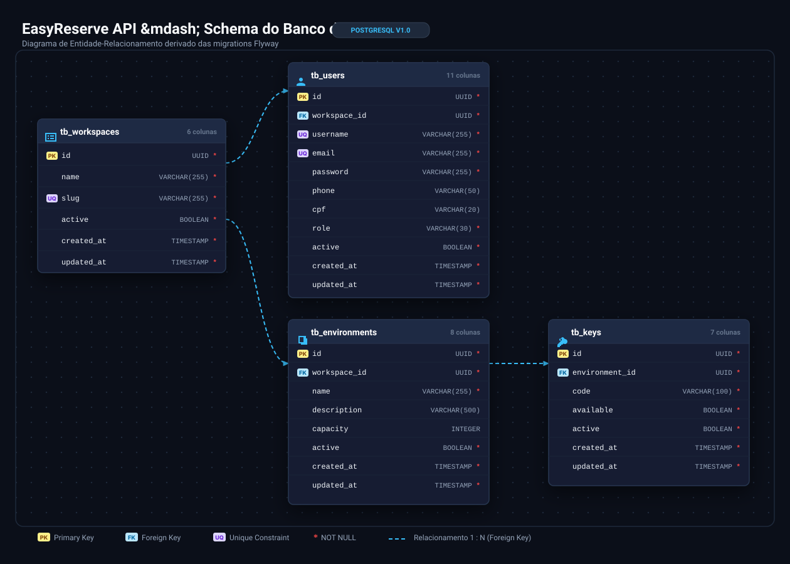
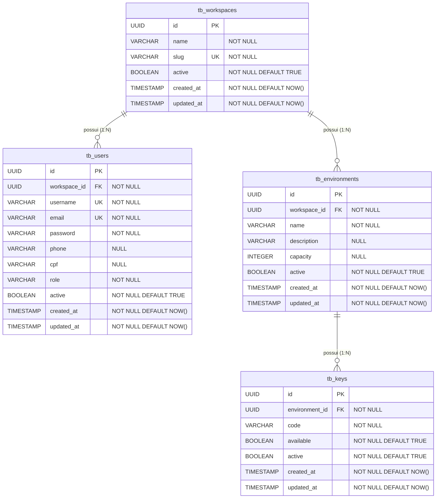

# Schema do Banco de Dados - EasyReserve API

Este documento descreve o modelo físico inicial do banco de dados relacional (PostgreSQL) gerenciado via Flyway.

---

## 📊 Diagrama Entidade-Relacionamento (Mermaid)

---

## 🗄️ Estrutura das Tabelas

### 1. `tb_workspaces`
Armazena as informações da instituição / espaço de trabalho de nível superior (escola, organização, filial).

| Coluna | Tipo | Restrições | Descrição |
| :--- | :--- | :--- | :--- |
| `id` | `UUID` | `PK`, `DEFAULT gen_random_uuid()` | Identificador único |
| `name` | `VARCHAR(255)` | `NOT NULL` | Nome do espaço de trabalho |
| `slug` | `VARCHAR(255)` | `NOT NULL`, `UNIQUE` | Slug para rotas amigáveis |
| `active` | `BOOLEAN` | `NOT NULL`, `DEFAULT TRUE` | Status ativo/inativo |
| `created_at`| `TIMESTAMP` | `NOT NULL`, `DEFAULT NOW()` | Data de criação |
| `updated_at`| `TIMESTAMP` | `NOT NULL`, `DEFAULT NOW()` | Data de última atualização |

---

### 2. `tb_users`
Armazena os usuários e credenciais para autenticação e autorização via JWT.

| Coluna | Tipo | Restrições | Descrição |
| :--- | :--- | :--- | :--- |
| `id` | `UUID` | `PK`, `DEFAULT gen_random_uuid()` | Identificador único |
| `workspace_id` | `UUID` | `FK -> tb_workspaces(id)`, `NOT NULL` | Workspace ao qual pertence |
| `username` | `VARCHAR(255)` | `NOT NULL`, `UNIQUE` | Nome de login do usuário |
| `email` | `VARCHAR(255)` | `NOT NULL`, `UNIQUE` | E-mail do usuário |
| `password` | `VARCHAR(255)` | `NOT NULL` | Hash da senha (BCrypt) |
| `phone` | `VARCHAR(50)` | `NULL` | Telefone de contato |
| `cpf` | `VARCHAR(20)` | `NULL` | CPF do usuário |
| `role` | `VARCHAR(30)` | `NOT NULL` | Perfil (`ADMIN`, `OWNER`, `COMMON`) |
| `active` | `BOOLEAN` | `NOT NULL`, `DEFAULT TRUE` | Status ativo/inativo |
| `created_at`| `TIMESTAMP` | `NOT NULL`, `DEFAULT NOW()` | Data de criação |
| `updated_at`| `TIMESTAMP` | `NOT NULL`, `DEFAULT NOW()` | Data de última atualização |

---

### 3. `tb_environments`
Armazena os ambientes, salas de aula, laboratórios ou auditórios disponíveis para reserva.

| Coluna | Tipo | Restrições | Descrição |
| :--- | :--- | :--- | :--- |
| `id` | `UUID` | `PK`, `DEFAULT gen_random_uuid()` | Identificador único |
| `workspace_id` | `UUID` | `FK -> tb_workspaces(id)`, `NOT NULL` | Workspace vinculado |
| `name` | `VARCHAR(255)` | `NOT NULL` | Nome do ambiente (ex: "Laboratório 1") |
| `description` | `VARCHAR(500)` | `NULL` | Descrição detalhada do local |
| `capacity` | `INTEGER` | `NULL` | Capacidade máxima de pessoas |
| `active` | `BOOLEAN` | `NOT NULL`, `DEFAULT TRUE` | Status ativo/inativo |
| `created_at`| `TIMESTAMP` | `NOT NULL`, `DEFAULT NOW()` | Data de criação |
| `updated_at`| `TIMESTAMP` | `NOT NULL`, `DEFAULT NOW()` | Data de última atualização |

* **Constraint Composta**: `UNIQUE (workspace_id, name)` — garante que não existam ambientes com o mesmo nome no mesmo workspace.

---

### 4. `tb_keys`
Armazena os registros físicos ou lógicos de chaves associadas aos ambientes.

| Coluna | Tipo | Restrições | Descrição |
| :--- | :--- | :--- | :--- |
| `id` | `UUID` | `PK`, `DEFAULT gen_random_uuid()` | Identificador único |
| `environment_id`| `UUID` | `FK -> tb_environments(id)`, `NOT NULL`| Ambiente correspondente |
| `code` | `VARCHAR(100)` | `NOT NULL` | Código identificador (tag/etiqueta) |
| `available` | `BOOLEAN` | `NOT NULL`, `DEFAULT TRUE` | Se a chave está disponível para retirada |
| `active` | `BOOLEAN` | `NOT NULL`, `DEFAULT TRUE` | Status ativo/inativo da chave |
| `created_at`| `TIMESTAMP` | `NOT NULL`, `DEFAULT NOW()` | Data de criação |
| `updated_at`| `TIMESTAMP` | `NOT NULL`, `DEFAULT NOW()` | Data de última atualização |

* **Constraint Composta**: `UNIQUE (environment_id, code)` — evita chaves com o mesmo código no mesmo ambiente.

